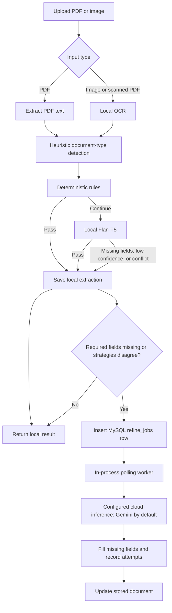

# ParseTrail

ParseTrail extracts structured fields from uploaded financial documents using rules, local Flan-T5 inference, and queued cloud refinement.

**Live demo:** TODO: insert the deployed Render/Vercel URL (set `VITE_BACKEND_URL` to your Render backend).

## Screenshots


## Features

- Extracts text from PDFs and OCRs images or scanned PDFs.
- Detects document types with lightweight text heuristics.
- Runs deterministic field rules, then local Flan-T5 when needed.
- Escalates selected rules/model field conflicts to cloud refinement; Gemini is the default provider.
- Queues incomplete or conflicting local results in MySQL for an in-process worker with exponential retries.
- Supports field corrections and correction history.
- For the same user and document type, matches duplicates by vendor, invoice number, amount, and currency, then updates the existing record.
- Filters the document list by type.
- Shows a 30-day dashboard summary and exports it as CSV or PDF.
- Shows a per-document extraction-attempt timeline (latest attempts in the UI).

## How it works



Uploads run the local stages synchronously. A MySQL-backed worker performs a cloud pass only when required fields are missing or stages disagree; cloud results fill missing stored fields.

## Tech stack

- **Backend:** Node.js, Express, TypeScript
- **Frontend:** React, TypeScript, Vite
- **Database and jobs:** MySQL 8, `mysql2`, in-process polling worker
- **Schema and files:** backend creates/updates MySQL tables at startup; uploaded files stay under `backend/uploads`
- **Extraction:** `pdf-parse`, `pdftotext` fallback, Tesseract.js OCR, regex rules, Transformers.js with `Xenova/LaMini-Flan-T5-77M`
- **Cloud refinement:** Google Gemini by default; provider is configurable
- **Local database:** MySQL database `parsetrail`

Project docs: [PRD](docs/ParseTrail-PRD.md) · [Technical spec](docs/TECHNICAL_SPEC.md) · [Architecture](docs/ARCHITECTURE.md) · [Test plan](docs/TEST_PLAN.md)

## Quick start

Requirements: Node.js 20+, npm, and a running MySQL 8 server. Docker is optional.

Create the local database and application user (or grant the same privileges to the values you use in `backend/.env.example`):

```bash
sudo mysql
```

In the MySQL prompt:

```sql
CREATE DATABASE IF NOT EXISTS parsetrail;
CREATE USER IF NOT EXISTS 'parsetrail_user'@'localhost' IDENTIFIED BY 'parsetrail_pass';
ALTER USER 'parsetrail_user'@'localhost' IDENTIFIED BY 'parsetrail_pass';
GRANT ALL PRIVILEGES ON parsetrail.* TO 'parsetrail_user'@'localhost';
FLUSH PRIVILEGES;
EXIT;
```

Then configure the backend:

```bash
test -f backend/.env || cp backend/.env.example backend/.env
```

If `sudo mysql` is unavailable, connect as your MySQL administrator with `mysql -u root -p`. Keep `DB_NAME`, `DB_USER`, and `DB_PASSWORD` in `backend/.env` consistent with the database and user you created. Do not commit `.env`.

In one terminal:

```bash
cd backend
npm ci
npm run dev
```

In another terminal:

```bash
cd frontend
npm ci
npm run dev
```

Open `http://localhost:5173`. Configure `backend/.env` for your local database. Set `AI_API_KEY` to enable queued cloud refinement; local extraction does not require it.

On backend startup, `ensureSchema()` creates or migrates the application tables in the configured database. Document records and extraction history are stored in MySQL; original uploads are stored on local disk under `backend/uploads` by default.

## Roadmap

- **Planned — Phase 3:** move the database to AWS RDS.
- **✓ Built:** dead-letter queue (`refine_jobs` `dead` status) and dead-job reprocessing (`POST /documents/:id/refinement/retry`).
- **✓ Done:** real provider token usage recorded per extraction attempt (no longer zero estimates).
- **Not used (dropped):** S3/SQS/Lambda — extraction runs on local disk + the MySQL jobs table; no AWS infrastructure is required.
