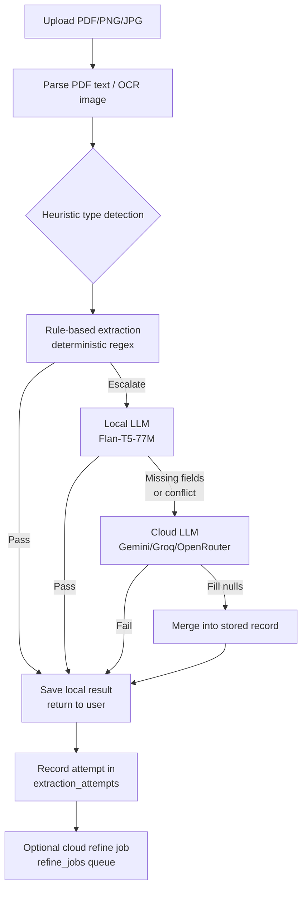

# ParseTrail — Architecture

## Extraction Cascade

The core of ParseTrail is a tiered, confidence-scored extraction cascade.
Instead of one opaque cloud call, every document flows through cheaper stages
first, escalating only when required.

## How a document flows (10 lines)

1. User uploads a PDF/PNG/JPG via the web frontend.
2. Backend saves the file, creates a `documents` row with status `pending`.
3. Text is extracted (pdfjs-dist → pdftotext → tesseract.js OCR as fallback).
4. Heuristic detection votes on document type (invoice/receipt/payment/bill/payslip/settlement_slip).
5. Deterministic regex rules extract vendor, date, total, currency; confidence = filled/5 × 0.85.
6. If rules pass, result is saved and returned inline (≈36% of docs skip the model).
7. Otherwise local Flan-T5 extracts missing fields; rule values win on conflict.
8. If still incomplete or strategies disagreed, a `refine_jobs` row is enqueued.
9. A background worker (15s poll, rate bucket + daily cap) runs cloud refinement.
10. Cloud fills nulls; every attempt (method, confidence, latency, cost) is logged.

## Key design decisions

- **Rules-first**: Deterministic rules run before the ML model; ~36% of documents skip model inference entirely (PRD deviation #10).
- **Rules win on conflict**: On rules-vs-model disagreement for number/date/amount/currency, the deterministic rule value is kept AND cloud arbitration is forced (PRD deviation #16).
- **No silent failures**: Every extraction attempt is recorded in `extraction_attempts`; cloud quota is spent only on successful calls.
- **Zero new infra**: Async refinement uses a DB-backed `refine_jobs` table + in-process Node worker, not SQS/Lambda (PRD deviation #3).
- **Local-first**: OCR via tesseract.js; local model via transformers.js; no AWS required.